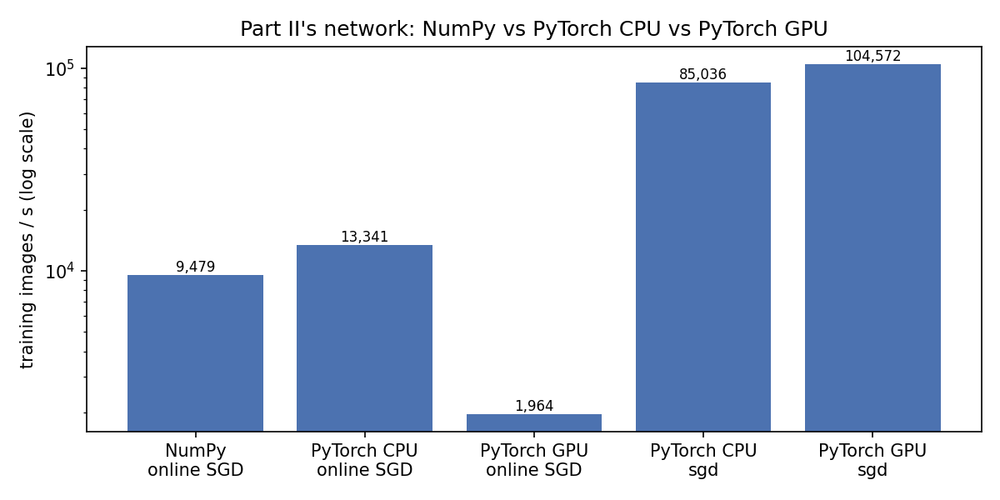
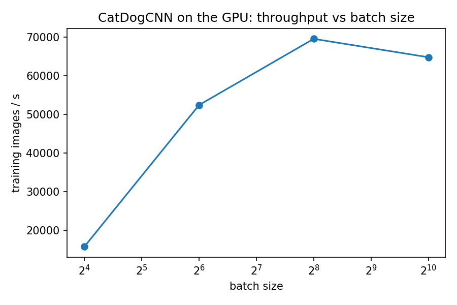

# Part II (NumPy) vs Part III (PyTorch on the GPU)

Generated by `compare/compare.py` from the result JSON files. Train and test times are
computation only (image loading and decoding excluded), as defined in each JSON's
`timing.definition`. Test images are the unseen `test/` split. Speed-ups are
ratios of times on the same machine. Each row is one run (1 warm-up, then 10 epochs and
one pass over the test set).

GPU training is not bit-for-bit reproducible: some cuDNN kernels add in a different order
from run to run, so the same configuration and seed can differ by a percentage point or
two in accuracy (for example sigmoid + BCE, batch 64, seed 542 appears in sections 3 and 6
as two separate runs).

## 1. NumPy (Part II) vs GPU (Part III)

| Implementation | Network | Training | Hardware | Train s (10 epochs) | Train images/s | Test s | Test images/s | Test accuracy |
|---|---|---|---|---|---|---|---|---|
| NumPy | Part II network (NumPy) | online SGD, 1 image per update | AMD Ryzen 7 7800X3D 8-Core Processor | 2.810 | 7,118 | 0.1210 | 8,267 | 50.0% (one class only) |
| NumPy | Part II network (NumPy) | online SGD, 1 image per update | AMD Ryzen 7 9800X3D 8-Core Processor | 2.110 | 9,479 | 0.1079 | 9,269 | 50.0% (one class only) |
| PyTorch GPU | CatDogCNN, ReLU + MSE (handout) | adam, batch 64 | NVIDIA GeForce RTX 5070 Ti | 0.366 | 54,598 | 0.0401 | 24,935 | 50.0% (one class only) |
| PyTorch GPU | CatDogCNN, sigmoid + BCE | adam, batch 64 | NVIDIA GeForce RTX 5070 Ti | 0.377 | 53,085 | 0.0416 | 24,036 | 68.7% |

The two parts use different networks: Part II trains only the FC layer behind one fixed
random filter, Part III trains two convolution and two FC layers. Section 2 compares the
implementations on the same network.

## 2. Same network: Part II's network in NumPy and in PyTorch

| Implementation | Network | Training | Hardware | Train s (10 epochs) | Train images/s | Test s | Test images/s | Test accuracy | Train speed-up vs NumPy | Test speed-up vs NumPy |
|---|---|---|---|---|---|---|---|---|---|---|
| NumPy | Part II network (NumPy) | online SGD, 1 image per update | AMD Ryzen 7 9800X3D 8-Core Processor | 2.110 | 9,479 | 0.1079 | 9,269 | 50.0% (one class only) | 1.00× | 1.00× |
| PyTorch CPU | Part II network | online SGD, 1 image per update | AMD Ryzen 7 9800X3D 8-Core Processor | 1.499 | 13,341 | 0.0364 | 27,450 | 50.0% (one class only) | 1.41× | 2.96× |
| PyTorch GPU | Part II network | online SGD, 1 image per update | NVIDIA GeForce RTX 5070 Ti | 10.183 | 1,964 | 0.0404 | 24,757 | 50.0% (one class only) | 0.21× | 2.67× |
| PyTorch CPU | Part II network | sgd, batch 64 | AMD Ryzen 7 9800X3D 8-Core Processor | 0.235 | 85,036 | 0.0338 | 29,577 | 50.0% (one class only) | 8.97× | 3.19× |
| PyTorch GPU | Part II network | sgd, batch 64 | NVIDIA GeForce RTX 5070 Ti | 0.191 | 104,572 | 0.0384 | 26,018 | 50.0% (one class only) | 11.03× | 2.81× |

The online rows run Part II's algorithm step for step (same initial weights, same
shuffle order; `part3_torch_cnn/test_part3.py` checks that the weights match NumPy's).
The batch-64 rows change the algorithm to mini-batch SGD to show what batching does.

## 3. Output layer: the handout's ReLU + MSE vs sigmoid + BCE (CatDogCNN, GPU)

| Output and loss | Test accuracy by seed | Runs that predict one class only | Mean ± std |
|---|---|---|---|
| ReLU + MSE (handout) | 542: 50.0%, 543: 50.0%, 544: 69.6%, 545: 50.0% | 3 of 4 | 54.9% ± 9.8 |
| sigmoid + BCE | 542: 68.7%, 543: 68.4%, 544: 69.4%, 545: 68.5% | 0 of 4 | 68.8% ± 0.5 |

With a ReLU on the single output, a network whose outputs all fall below zero gets zero
gradient and stops learning: it then predicts one class for every image. A logit output
with BCEWithLogitsLoss always has a gradient.

## 4. CatDogCNN on the CPU vs the GPU (PyTorch, sigmoid + BCE)

| Data | Train / test images | CPU | GPU | CPU train s | GPU train s | Train speed-up | Test speed-up | Accuracy CPU / GPU |
|---|---|---|---|---|---|---|---|---|
| data_small | 2,000 / 1,000 | AMD Ryzen 7 9800X3D 8-Core Processor | NVIDIA GeForce RTX 5070 Ti | 3.203 | 0.377 | 8.5× | 4.4× | 68.9% / 68.7% |
| data (full) | 18,728 / 4,682 | AMD Ryzen 7 9800X3D 8-Core Processor | NVIDIA GeForce RTX 5070 Ti | 30.900 | 3.295 | 9.4× | 10.7× | 78.1% / 78.4% |

## 5. Input pipeline (CatDogCNN, sigmoid + BCE, GPU)

| Images reach the GPU by | Train s (10 epochs) | Train images/s | Test accuracy |
|---|---|---|---|
| decoded once, tensors kept in GPU memory | 0.377 | 53,085 | 68.7% |
| ImageFolder + DataLoader every epoch, 0 workers | 17.088 | 1,170 | 68.2% |
| ImageFolder + DataLoader every epoch, 4 workers | 4.635 | 4,315 | 69.3% |

For the disk rows the training time includes decoding and resizing every image on the CPU.

## 6. Batch size (CatDogCNN, sigmoid + BCE, GPU)

| Batch size | Train s (10 epochs) | Train images/s | Test accuracy |
|---|---|---|---|
| 16 | 1.268 | 15,770 | 68.7% |
| 64 | 0.382 | 52,405 | 66.8% |
| 256 | 0.288 | 69,531 | 66.1% |
| 1024 | 0.309 | 64,778 | 59.2% |

Larger batches give the GPU more parallel work per kernel launch, but also fewer weight
updates per epoch, which changes accuracy after a fixed number of epochs.

## Environment (Part III runs)

| Item | Value |
|---|---|
| python | 3.12.3 |
| torch | 2.11.0+cu128 |
| torchvision | 0.26.0+cu128 |
| numpy | 2.5.4 |
| platform | Linux-6.18.54.1-microsoft-standard-WSL2-x86_64-with-glibc2.39 |
| cpu | AMD Ryzen 7 9800X3D 8-Core Processor |
| logical_cpus | 16 |
| torch_cpu_threads | 8 |
| device | cuda |
| gpu | NVIDIA GeForce RTX 5070 Ti |
| gpu_capability | sm_120 |
| cuda_runtime | 12.8 |
| cudnn | 91900 |
| nvidia_driver | 610.88 |

